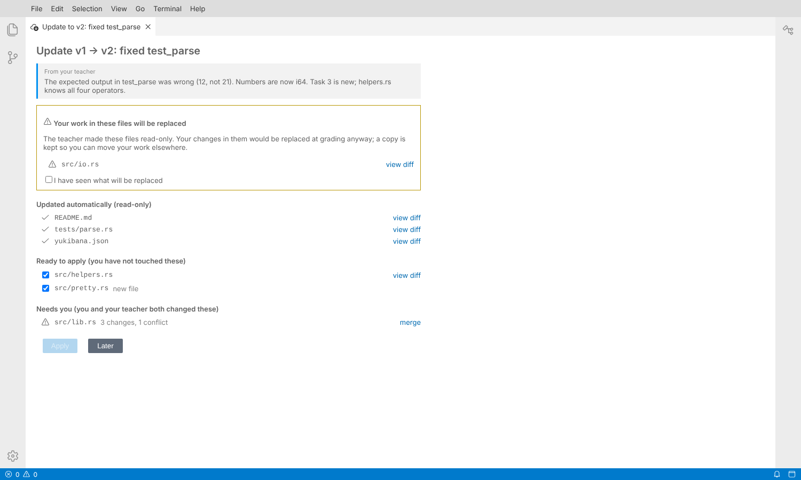
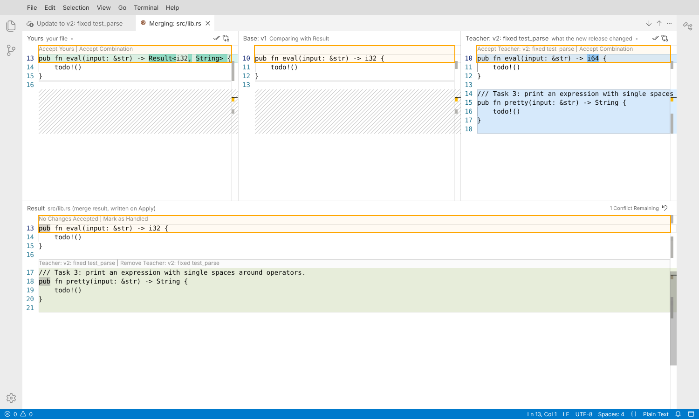

# Release updates in Theia (prototype)

A teacher publishes v2 of an assignment while students are working on v1.
This Theia extension brings v2 into a student's folder: read-only files are
replaced without asking, files the student never touched are updated with a
tick, and files both of them changed open in **Theia's own three-way merge
editor** (`@theia/scm`, the one VS Code's git uses), already merged where
the two sides do not clash. Nothing is written until Apply, which backs up
first and writes `yukibana.json` (the release stamp) last.

It is the design in section 8 of the assignment-versioning notes, built far
enough to try. The decisions are not in this folder: `planUpdate` and
`merge3` are in the CLI's library (`cli/src/lib/update.ts`,
`cli/src/lib/diff3.ts`), tested there, so `yukibana update` in a terminal
can make the same ones.





## Run it

```bash
npm run build --prefix ../../cli    # the library, once
npm install
npm run build
cp -r example/student /tmp/student  # Apply changes the folder it opens
YUKIBANA_RELEASES=$PWD/example/releases npm start -- /tmp/student
```

Open http://127.0.0.1:3000. The banner offers the update when the folder
opens; **Yukibana: Check for Assignment Update** asks again.

`example/` is a small Rust assignment with one of everything: a fixed
read-only test, a read-only README, a helper the student never touched, a
new file, a file the teacher made read-only after the student had edited
it (the warning), and `src/lib.rs`, where the teacher's change to `eval`
clashes with the student's and the rest merges cleanly.

## How it is put together

| | |
| --- | --- |
| `yukibana-update/src/node/update-service.ts` | The backend. Reads the folder, runs `planUpdate`, keeps the plan and the student's merge results, backs up to `~/.theia/yukibana-update-backups/` and writes. Refuses to write over a file that changed since the plan was made. |
| `yukibana-update/src/node/release-source.ts` | Where the two starters come from. A folder of releases for now; the registry once it can serve an older release's starter. |
| `yukibana-update/src/browser/update-widget.tsx` | The widget: release notes, then warning, automatic, ready and needs-you sections, and Apply. Opens the diff editor and the merge editor. |
| `yukibana-update/src/browser/update-resource.ts` | `yukibana-update:/<plan>/<base\|mine\|theirs\|result>/<path>`. The editors open these, so the merge editor never edits the student's file: saving the result stores it with the plan. |
| `yukibana-update/src/browser/update-diff-computer.ts` | Gives the merge editor the CLI's line diff for those URIs, so its blocks match the pre-merged result (Monaco's diff placed an appended function inside a nearby conflict). Every other diff stays Monaco's. |
| `browser-app/` | A browser Theia with the extension, to run it. |

## Using Theia's merge editor

It is generic, though only git opens it today. The extension opens it the
way `_open.mergeEditor` does for git:

```ts
const uri = MergeEditorUri.encode({ baseUri, side1Uri, side2Uri, resultUri });
await open(openerService, uri, { widgetState: { side1State: { title: 'Yours' }, side2State: { title: 'Teacher: v2' } } });
```

What it gives for free: Accept / Accept Combination per block on each side,
a conflict counter, next and previous conflict, Complete Merge (which saves
the result), and the layouts. Two things it decides for itself that matter
here:

* **The starting result is read, not computed.** It only recomputes it when
  the file has `<<<<<<<` markers. Otherwise each block counts as handled
  when the result there differs from the base. So the result URI serves
  `planUpdate`'s pre-merge (clean changes applied, conflicts left as the
  base had them), and the editor shows exactly the conflicts as open.
* **Its blocks come from the bound `DiffComputer`.** Hence
  `update-diff-computer.ts`.

## Not done yet

* The registry route for an older release's starter, and the stamp in
  starters (2a). The example's `yukibana.json` files carry a hand-written
  `release` stamp in the proposed shape.
* `yukibana update` in the CLI; the pure part it needs is here.
* Undo is offered once, in the notification after Apply; the backup stays
  on disk.
* Exams (`updates: auto`) and the Realtime trigger.
